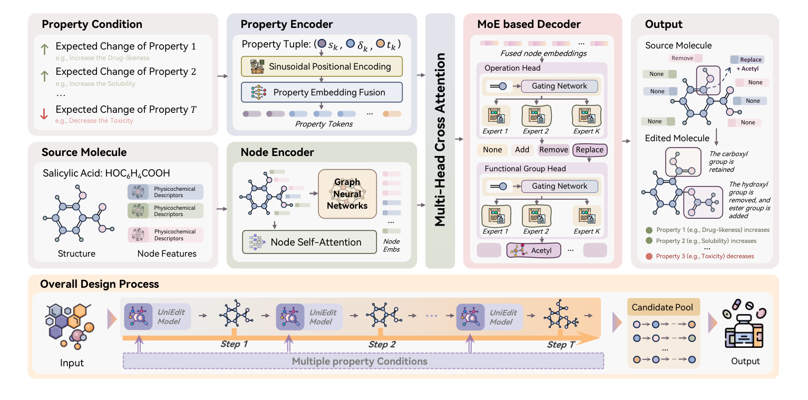
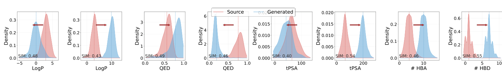
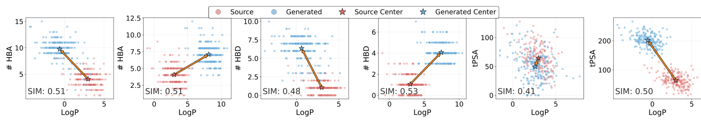
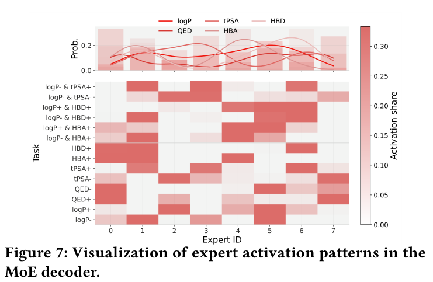
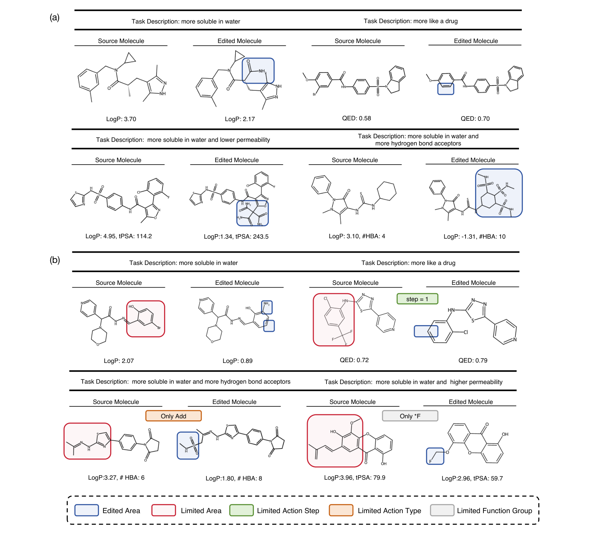

<div align="center">


# UniEdit

### A Graph-based MoE Alternative to Sequence Generation for Molecular Editing

**Precise graph edits. Specialized experts. Unified molecular optimization.**

[](https://doi.org/10.1145/3770855.3818878)
[](https://doi.org/10.1145/3770855.3818878)
[](#quick-start)

Jiajun Yu, Zhihao Wu, Yizhen Zheng, Shirui Pan, Jiajun Bu, and Haishuai Wang

[Highlights](#highlights) · [Method](#method) · [Results](#results) · [Quick start](#quick-start) · [Citation](#citation)

</div>

---

UniEdit formulates molecular editing as **hierarchical node-level classification on molecular graphs**. A graph-based mixture of experts predicts discrete edits under property conditions, providing a controllable alternative to autoregressive SMILES generation.

## Highlights

- **Edit the graph directly.** Predict atom-anchored add, remove, and replace operations instead of regenerating an entire molecule.
- **One model, multiple objectives.** Task-conditioned expert routing handles single-property and competing multi-property goals.
- **Strong optimization with compact models.** The paper reports **89.6% loose** and **82.7% strict** average hit ratios on single-property tasks.
- **Efficient inference.** The paper's efficiency study reports approximately **150 ms per molecule**, roughly **10× faster** than comparable LLM-based agents in that setup.

## Method

<p align="center">
  
</p>

*Figure 1 from the paper.* Dual-stream molecular and property encoding feeds a task-conditioned MoE decoder. Hierarchical predictions identify the edit location, operation, and functional group; trajectory search explores candidate transformations.

## Results

| Evaluation setting | UniEdit | Paper reference |
| :--- | ---: | :--- |
| Single-property · loose average hit ratio | **89.6%** | Table 1 |
| Single-property · strict average hit ratio | **82.7%** | Table 2 |
| Multi-property · average over loose and strict columns | **77.5%** | Table 3 |

These are reported paper results, not measurements from the lightweight demo. Loose evaluation checks the requested direction; strict evaluation additionally requires the task-specific improvement threshold. The paper evaluates 28 task/settings combinations; the released demo defines 14 task IDs.

<p align="center">
  
</p>

*Figure 5.* Generated property distributions shift in the requested directions while retaining structural similarity to the source molecules.

<details>
<summary><b>See multi-objective behavior, expert routing, and edit examples</b></summary>



*Figure 6.* Source and generated distributions illustrate simultaneous optimization of two properties.



*Figure 7.* Different objectives activate different experts, illustrating task-dependent specialization.



*Figure 8.* Representative transformations under unconstrained and structure-constrained optimization.

</details>

## Quick start

### 1. Prepare the environment

Use a PyTorch installation compatible with your hardware, and install RDKit, pandas, and PyYAML. The graph code also imports PyTorch Geometric; install a build compatible with your PyTorch version.

```bash
conda install -c conda-forge rdkit
pip install torch torch-geometric pandas pyyaml
```

### 2. Download the checkpoint

Download [the pretrained checkpoint](https://drive.google.com/file/d/1t4GDDtgKR69I9Y6BNEWqG9AOKQ3BQdgs/view?usp=drive_link) and save it as **`model.pth` in this repository root**, next to `infer_config.yaml`.

### 3. Run inference

Run all commands below from the repository root:

```bash
python infer_oneshot.py --infer_config infer_config.yaml
```

The demo reads `data/test_chatdrug.csv` from the `mol` column and writes one CSV per task to `output_/`, such as `output_/101_task.csv`. The `pred_smiles_list_json` column stores generated candidates.

The default device is `cuda:0`. For CPU execution, change `device: cpu` in `infer_config.yaml`.

### 4. Evaluate generated molecules

```bash
python evaluate.py \
  --test_data data/test_chatdrug.csv \
  --result_prefix output_ \
  --config_path tasks.yaml \
  --mol-col mol
```

## Repository guide

| Path | Purpose |
| :--- | :--- |
| [`infer_oneshot.py`](infer_oneshot.py) | Inference entry point |
| [`infer_config.yaml`](infer_config.yaml) | Checkpoint, inputs, tasks, sampling, and device |
| [`mo_gnn_edit/`](mo_gnn_edit/) | Graph modeling, edit execution, training, and inference |
| [`tasks.yaml`](tasks.yaml) | Property directions and evaluation thresholds |
| [`evaluate.py`](evaluate.py) | Evaluation of generated molecules |
| [`assets/figures/`](assets/figures/) | Figures reproduced from the paper |

## Citation

```bibtex
@inproceedings{yu2026uniedit,
  title     = {{UniEdit}: A Graph-based {MoE} Alternative to Sequence Generation for Molecular Editing},
  author    = {Yu, Jiajun and Wu, Zhihao and Zheng, Yizhen and Pan, Shirui and Bu, Jiajun and Wang, Haishuai},
  booktitle = {Proceedings of the 32nd ACM SIGKDD Conference on Knowledge Discovery and Data Mining V.2},
  year      = {2026},
  doi       = {10.1145/3770855.3818878},
  pages     = {12739--12750}
}
```
